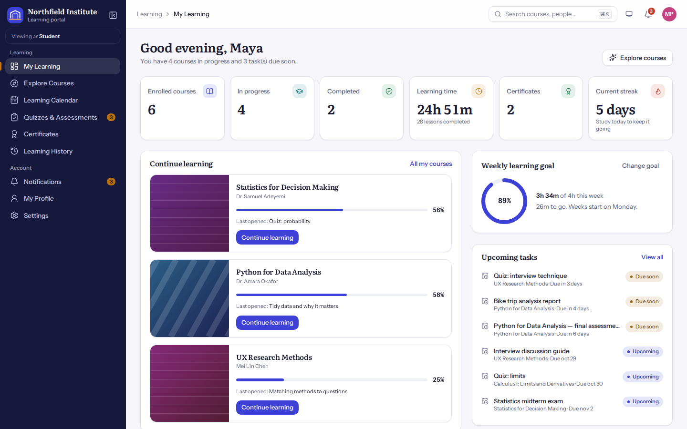
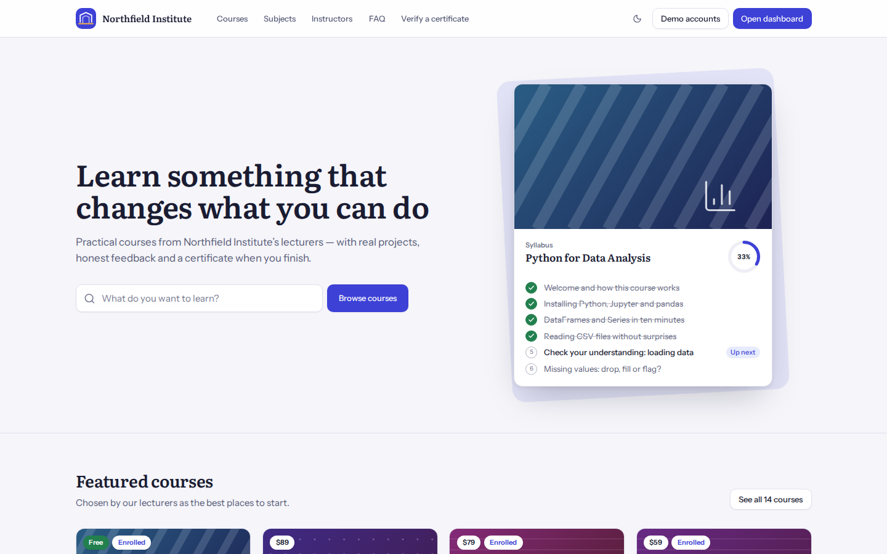
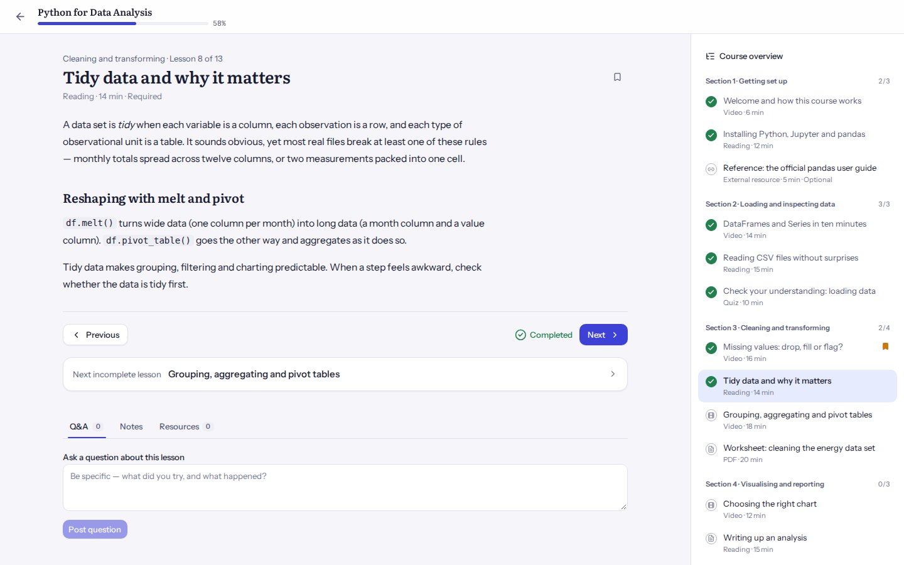
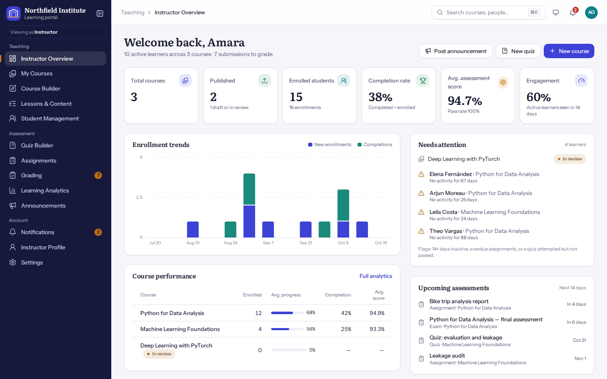
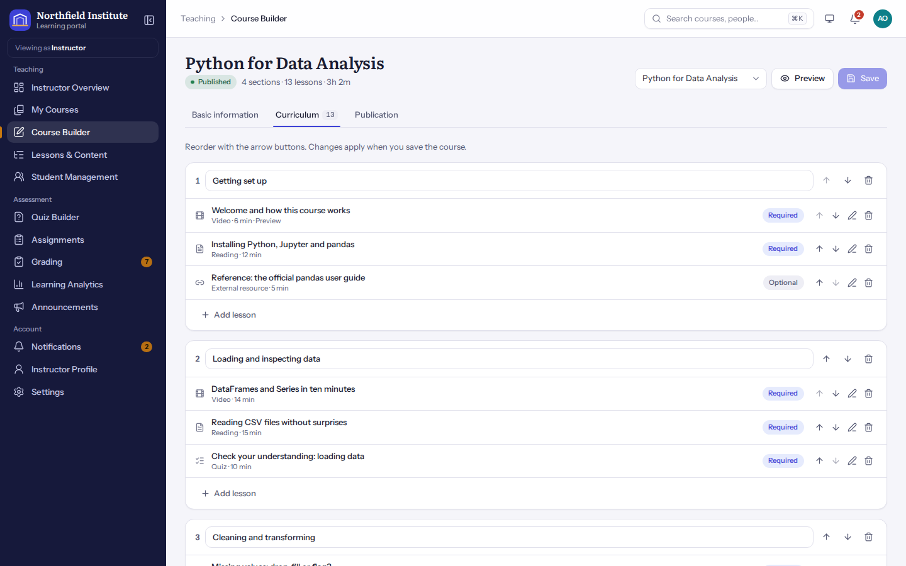
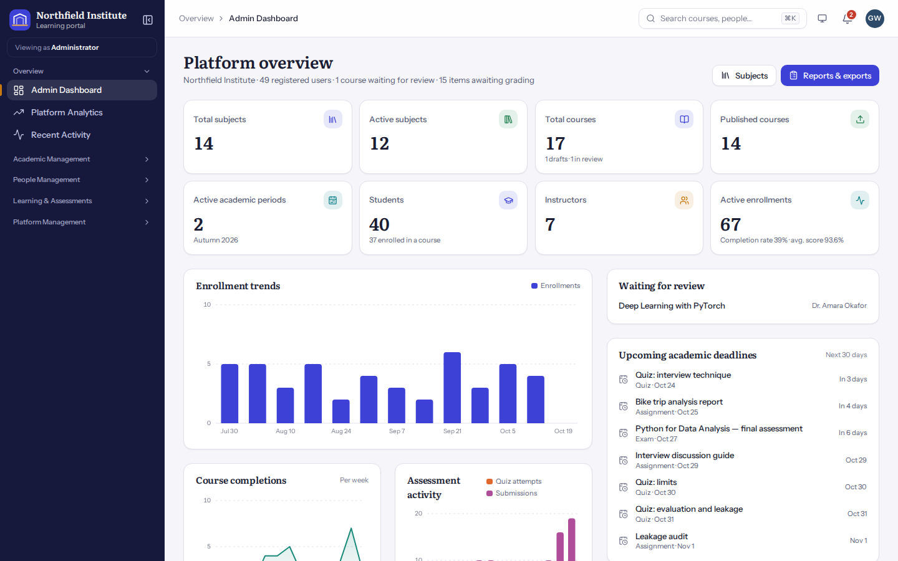
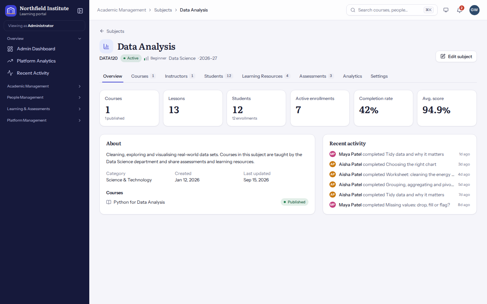
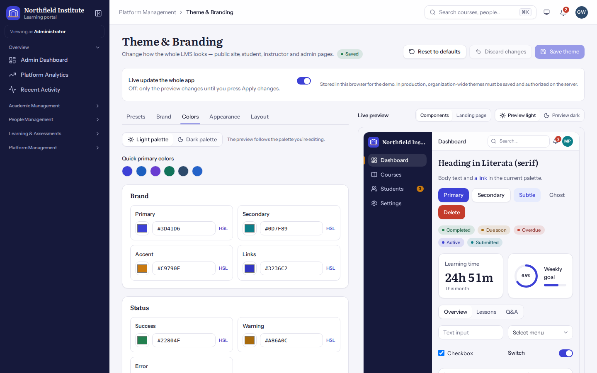
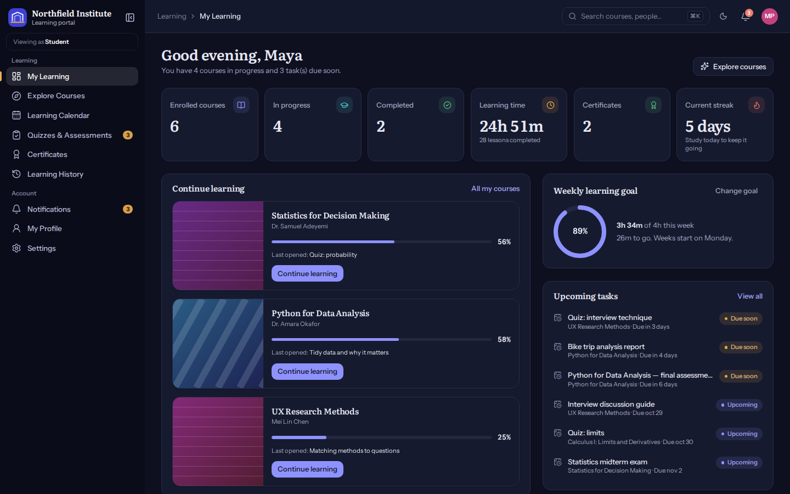
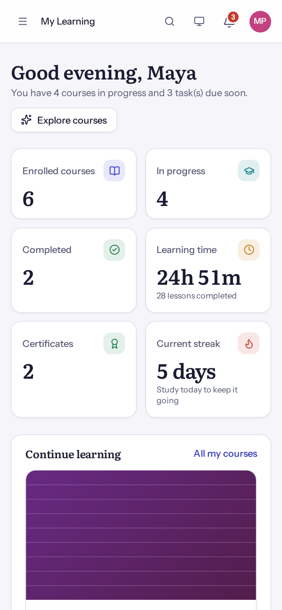

# Lectern — Learning Management System Template

A responsive LMS template built with React 19, TypeScript, Vite and Tailwind CSS 4. It includes student, instructor and administrator experiences — courses, lessons, quizzes, assignments, certificates, analytics, academic management and a live theme editor — all running on one consistent set of demo data.

The demo institution is **Northfield Institute**, a fictional college. All people, courses, enrollments and grades are made up.



| | |
|---|---|
|  |  |
|  |  |
|  |  |
|  |  |



---

## Quick start

Requires Node.js 20 or later.

```bash
npm install
npm run dev              # http://localhost:5173
```

| Script | What it does |
|---|---|
| `npm run dev` | Development server with hot reload |
| `npm run build` | Type check, then production build to `dist/` |
| `npm run preview` | Serve the production build |
| `npm run typecheck` / `npm run lint` | TypeScript checks (strict, no unused code) |
| `npm run test:unit` | Business-rule tests: no browser, takes seconds |
| `npm run test:install` | Download the Chromium build Playwright uses (once) |
| `npm run test:e2e` | End-to-end tests against the production build, desktop and mobile |
| `npm test` | Unit tests, then end-to-end tests |

## Demo accounts

There's no sign-in. Pick an account with **Demo accounts** in the site header, or **Switch demo account…** in the account menu.

| Role | Accounts | Starts at |
|---|---|---|
| Student | Maya Patel (default) plus 39 other learners | `/learn` |
| Instructor | Dr. Amara Okafor, Daniel Reyes, Mei Lin Chen and 4 more | `/teach` |
| Administrator | Grace Whitfield, Jonas Berg | `/admin` |

Opening another role's area shows a prompt to switch accounts. **Role switching is a demo convenience, not authentication.**

## Features

### Public site
- Landing page with a hero, course search and a "syllabus" visual. Its sections (featured courses, categories, benefits, instructors, live statistics, testimonials, FAQ, call to action) can be reordered and hidden by administrators.
- Course catalog:
  - Search by title, instructor or tag.
  - Filters for category, difficulty, duration, rating and price.
  - Sort by popularity, newest, rating or title.
  - "Load more". Filters live in the URL.
- Course pages: objectives, prerequisites, curriculum with free preview lessons, instructor, reviews, related courses, enrollment, and a demo checkout for paid courses.
- Certificate verification at `/verify/:code`, showing valid, revoked or not found.

### Students
- **Dashboard:**
  - Stats: enrolled, in progress, completed, learning time, certificates and streak.
  - Continue learning, and an activity chart for week, month or 12 weeks.
  - Upcoming tasks.
  - Recommendations, which are rule-based and labelled as such.
  - Achievements and an editable weekly goal.
- **Lesson player:** video, text, PDF, external-link and quiz lessons, with a curriculum sidebar (a drawer on mobile).
  - Previous/next and mark as complete, plus a suggested "next incomplete lesson".
  - Bookmarks, private notes, lesson Q&A with replies, and downloadable resources.
- **Quizzes:**
  - Instructions, timer and question navigation, with a clear-answer button and confirmation of unanswered questions.
  - Results with answer review (as the review policy allows) and attempt history.
  - Attempt limits, and written answers held for grading.
- **Assignments:** text responses and demo attachments, late handling, grades and feedback, returned-for-revision status.
- Also: learning calendar, assessments overview, certificates (print or save as PDF), learning history with CSV export, notifications, profile and settings.

### Instructors
- **Dashboard:** course and learner metrics, enrollment trends, course performance, a "needs attention" list (rule-based flags), upcoming assessments, recent reviews.
- **Course builder:**
  - Basic information: thumbnail upload or generated cover art.
  - Curriculum: sections and lessons, reordered with move up/down buttons, required/optional and preview toggles, and resources per lesson.
  - Publication: a checklist and review workflow.
- **Courses table:** duplicate, publish or unpublish, archive, and delete (blocked when enrollments exist).
- **Assessments:**
  - Quiz builder with four question types, points, pass mark, time limit, attempts, availability dates, review policy and preview mode.
  - Question bank with CSV import and export. Adding a question copies it, so editing the bank never changes a quiz.
  - Assignment review and a combined **Grading** page with manual grading.
- **Students:** enroll (duplicates are rejected), suspend, reactivate or remove, per-student progress detail, and CSV export.
- Learning analytics with date ranges, and announcements that notify enrolled students.

### Administrators
- **Navigation:** five collapsible groups — Overview, Academic Management, People Management, Learning & Assessments, Platform Management.
- **Academic structure:** academic years, terms, faculties, departments, subject categories, course categories, sections, lessons, learning resources and learning groups.
  - Records that are still in use can't be deleted.
  - Archiving keeps history.
  - Unused levels can be switched off in Platform Settings.
- **Subjects**, a first-class entity separate from courses:
  - CRUD, codes unique per academic year, and filters by category, department, year, term, instructor and status.
  - Sorting, pagination, bulk archive/restore/delete/export and CSV export.
  - A detail page with Overview, Courses, Instructors, Students, Learning Resources, Assessments, Analytics and Settings tabs.
  - Safe archive, and a "move courses" step before deletion.
- **People:** students, instructors and administrators. Create demo users, edit, change roles, and activate/deactivate.
  - Instructors who own courses must have them reassigned before changing role.
  - At least one active administrator must remain.
  - A roles & permissions matrix, student batches and enrollments.
- **Learning & assessments:** quiz management, exams, question bank, assignments, grades & results, and certificates (issue for eligible completions, revoke with a public reason, reinstate).
- **Platform:**
  - Course review moderation, notifications, and eight CSV report exports.
  - Platform settings, Theme & Branding, Website Appearance, Navigation & Menus, an activity log, and demo data backup/reset.

## Theme customization

Open **Admin → Theme & Branding**.

- **Presets:** Modern Indigo (default), Academic Blue, Violet Learning, Emerald Academy, Warm Neutral and Midnight Dark. Each is a complete light and dark palette plus appearance settings. Pick one, then customize it.
- **Brand:** platform name, tagline, description, logo and favicon (local uploads), and "restore default brand identity".
- **Colors:**
  - Separate light and dark palettes with 14 tokens each: primary, secondary, accent, links, success, warning, error, page background, cards, text, secondary text, borders, sidebar and sidebar text.
  - A color picker, hex input with validation (invalid values are never applied), HSL inputs, quick primaries, recent colors, and per-color reset to the preset.
  - Contrast checks: saving is blocked if body or sidebar text becomes unreadable.
- **Appearance:** default color mode (light, dark, system), body and heading fonts (bundled, OFL-licensed), text size, density, corner radius, card style, shadow intensity, button shape, and reduced motion.
- **Layout:** sidebar style, default collapsed sidebar, header style, content width, course card style, and which student dashboard widgets are shown.
- **Preview and saving:**
  - A live preview of the components or the landing page, in light or dark.
  - Edits apply to the whole app immediately. Turn off **Live update** to change only the preview, then use **Apply changes**.
  - **Save theme** persists, **Discard changes** returns to the saved theme, and **Reset to defaults** loads the default preset.
  - If unsaved changes are being previewed elsewhere, a banner says so.

**How it works.** `src/services/theme.ts` turns a `Theme` object into CSS custom properties on `<html>`. `src/styles/index.css` derives hover, soft and faint shades from those with `color-mix()`. Components only use these tokens through Tailwind utilities such as `bg-primary`, `text-muted` and `border-line`, so no component hard-codes a color.

To change the shipped defaults, edit `PRESETS` in `src/services/theme.ts`. Stored themes pass through `sanitizeTheme()`, so bad values from storage or imports are replaced, never applied.

Website content (headline, sections, featured courses, testimonials, FAQ, footer) lives in **Website Appearance**, and menu labels in **Navigation & Menus**. Both preview before saving and update the real public site when saved.

## Architecture

```
src/
  app/            routes (code-split per page), role navigation
  components/     ui (buttons, fields, dialogs, tables, badges, stat cards), layout (shells, sidebar, search),
                  charts (dependency-free SVG with screen-reader tables), courses (cards, generated cover art)
  features/       public, student, learning (player), assessments, courses, certificates,
                  instructor, admin (academic, users, theme), notifications, settings
  services/       pure business rules — learning (progress, enrollment, certificates), assessment (scoring,
                  attempts), analytics (shared metric definitions), courses, tasks, student, permissions, theme
  state/          store.tsx (state, persistence, theme application), actions.ts (every mutation, validated),
                  selectors.ts
  data/           content.ts (hand-written courses and quizzes), seed.ts (deterministic generator, relative to today)
  types/          the domain model
tests/
  unit/           business rules, seed consistency, store actions
  e2e/            learner, instructor/admin and theme workflows; every main route at desktop and phone sizes
```

- **One source of truth.** Pages read `data` and call `actions`. Each action validates against the latest state and either commits a new snapshot or returns field errors, so the same rules apply whichever page triggers them. No component touches storage.
- **Consistent numbers.** Every dashboard, report and export uses `services/analytics.ts`:
  - **enrolled:** active + completed enrollments. Suspended and cancelled ones are kept but excluded.
  - **completion rate:** completed ÷ enrolled.
  - **average score:** each student's best graded attempt per quiz.
  - **engagement:** active learners seen in the last 14 days.
- **Course completion.** A course completes when every required lesson is complete. Quiz lessons complete when the quiz is passed (configurable in Platform Settings). Completing a course issues one certificate per enrollment if the course awards one.
- **Courses vs subjects.** A subject is an academic area. A course optionally belongs to one.
  - The full hierarchy is academic year → term → department → subject → course → section → lesson.
  - Every level above course is optional.

### Connecting a backend

1. Replace `src/services/persistence.ts` (`load` / `save` / `remove`) with API calls, and hydrate `data` from your server.
2. Make each function in `src/state/actions.ts` call the matching endpoint. Keep the validation, and **repeat it on the server**.
3. Add real authentication. Replace the demo account switcher (`DemoSwitcherProvider`) and `currentUserId` with your identity provider's session.
4. Enforce `src/services/permissions.ts` server-side for every request.

## Demo limitations

This template runs entirely in the browser. These parts need a backend before production:

| Area | In this demo | In production |
|---|---|---|
| Accounts & roles | Demo account switcher; permission checks run in the browser | Real authentication; authorize every request and role change on the server |
| Data | `localStorage` in one browser (about 450 KB); no sync | Database and API |
| Quiz timing & attempts | Enforced in the browser; a determined user can bypass them | Start, time and grade attempts on the server; never send correct answers early |
| File uploads | Assignments record file names and sizes only; logos, avatars and thumbnails are local data URLs | Object storage (S3, Cloudinary…) with type and size checks |
| Payments | Paid courses show a demo checkout; nothing is charged | Payment provider (e.g. Stripe) and webhooks |
| Certificates | IDs are random codes checked against local data | Server-issued, signed records verified by the server |
| Notifications | In-app only; no email or push | Email or push delivery service |
| Video | Labeled placeholder unless a lesson has an MP4, YouTube or Vimeo URL | Video hosting |
| Translations | Language setting changes date and number formats only | i18n library and translated strings |

Security notes:
- Lesson text is rendered from a small markdown subset as React elements, never as HTML.
- Links, media and resources must be `http(s)` or same-origin paths.
- Uploaded images are only ever used as ``.
- CSV exports escape cells that look like spreadsheet formulas.

## Stack and dependencies

React 19, React Router 7, TypeScript, Vite 8, Tailwind CSS 4, lucide-react icons, and three Fontsource fonts. Tests use Playwright.

The suggested stack also listed Recharts, React Hook Form + Zod, date-fns and a toast library. This template deliberately does without them, to keep the bundle and dependency list small:
- **Charts** are small SVG components with tooltips and screen-reader tables.
- **Form validation** lives in the store actions, which are the single place rules are enforced.
- **Dates** use `src/lib/date.ts`, which treats calendar dates as local `YYYY-MM-DD` strings.
- **Toasts** are a 50-line component.

## License

Proprietary — see [LICENSE](LICENSE). All demo content is fictional; bundled fonts are SIL OFL and icons ISC.
